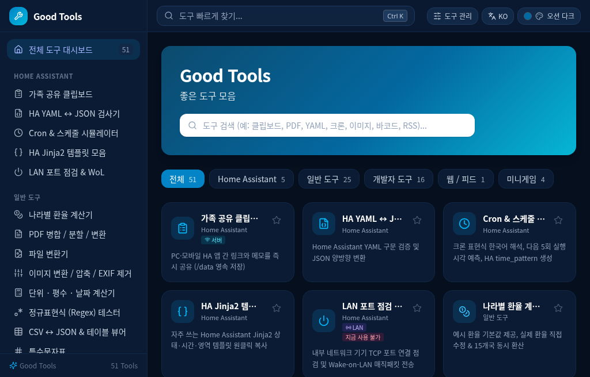
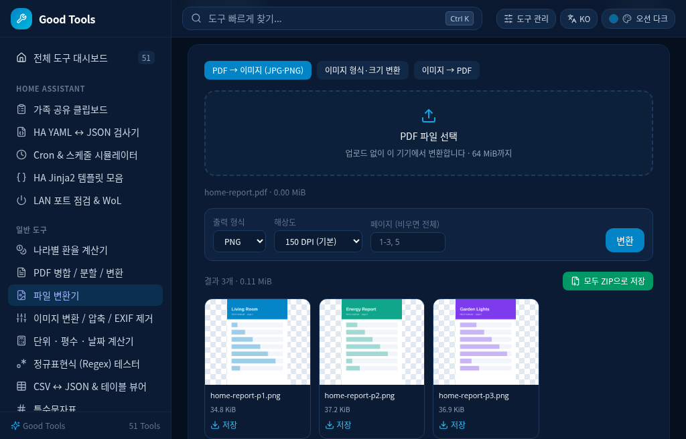
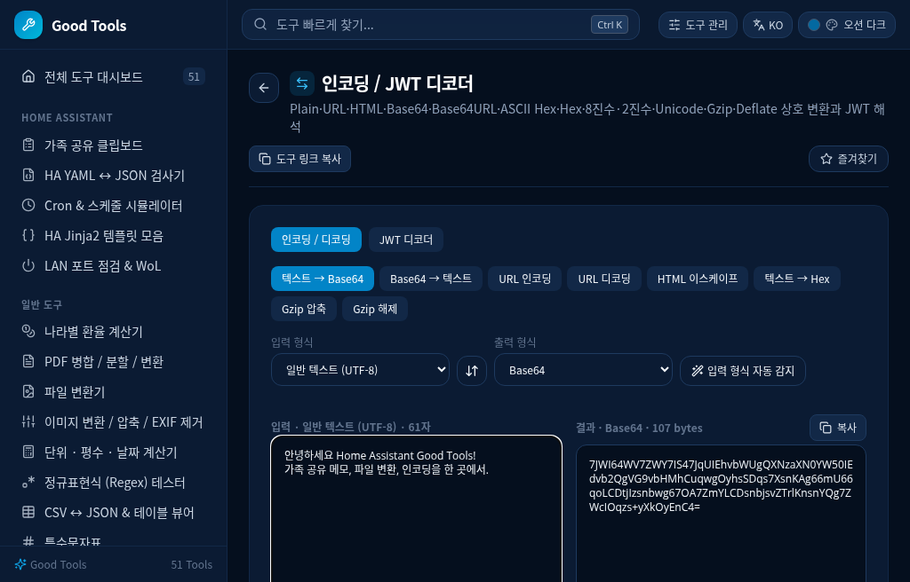

# Good Tools for Home Assistant

**English** · [한국어](README.md)

[](https://my.home-assistant.io/redirect/supervisor_add_addon_repository/?repository_url=https%3A%2F%2Fgithub.com%2Fredchupa%2Fha_good_tools)

A Home Assistant app that keeps the small tools you only need once in a while in one place.

Merging PDFs, shrinking a photo, making a QR code, counting characters. You don't do these often, but when you do, the sites you find are usually full of ads or want you to sign up. And uploading personal documents or photos to a site you don't know never feels great.

So I put them in the Home Assistant sidebar, which is running 24/7 at home anyway, so they're always one click away.

---

## Where it comes in handy

- **Tidying up PDF documents**
  Merge several PDFs into one, pull out only the pages you need, or turn PDF pages into JPG/PNG images. Files are processed in your browser and are not uploaded anywhere.

- **Shrinking photos and removing location data before sharing**
  Change the size and format of a photo and strip the GPS location and camera information at the same time.

- **Moving a link or note from your PC to your phone**
  Paste it into the shared clipboard and copy it from the Home Assistant app on your phone. Notes you use often can be pinned to the top.

- **Giving guests your Wi-Fi password**
  Make a QR code from your Wi-Fi name and password, and guests can connect just by pointing their camera at it.

- **Writing Home Assistant automations**
  Check YAML syntax, preview when a cron expression will run, and keep common Jinja templates in one place.

There are more than 50 everyday and developer tools in total. The interface is available in English and Korean.

---

## Screenshots

Favorites and hidden tools are shared between your PC and phone.

<p align="center">
  
</p>

<p align="center">
  
</p>

<p align="center">
  
</p>

---

## Installation

1. Click the **Add Repository** button above, or add this URL under **Settings → Apps (Add-ons) → App store → ⋮ (top right) → Repositories** in Home Assistant:
   ```text
   https://github.com/redchupa/ha_good_tools
   ```
2. Find **Good Tools** in the list, **install** it and **start** it.
3. Turn on **Show in sidebar** to open it from the left menu.

Options are described in the app's **Documentation** tab.

---

## Support

If this app is useful to you, you can support it here:

<p align="center">
  <a href="https://github.com/sponsors/redchupa"></a>
  <a href="https://www.paypal.com/ncp/payment/HG9KNC262PLAC"></a>
</p>

---

## License

[MIT License](LICENSE)
