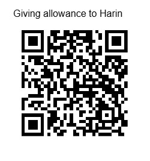

# Good Tools for Home Assistant

[](https://my.home-assistant.io/redirect/supervisor_add_addon_repository/?repository_url=https%3A%2F%2Fgithub.com%2Fredchupa%2Fha_good_tools)

광고·추적 없이 Home Assistant 사이드바(Ingress)에서 바로 사용할 수 있는 **올인원 온라인 유틸리티 · Home Assistant 특화 · 개발자 도구 모음** 앱(Add-on)입니다.

## 주요 특징

- **Home Assistant 사이드바(Ingress) 네이티브 통합**: 별도 포트 개방이나 로그인 없이 HA 사이드바에서 바로 사용합니다.
- **PC ↔ 모바일 설정 자동 동기화**: 즐겨찾기, 도구 숨기기, 언어 설정 및 가족 공유 클립보드가 HA `/data` 볼륨에 영속 저장됩니다.
- **광고·추적 제로, 로컬 우선 처리**: PDF 병합/분할, 이미지 압축/EXIF 제거, 파일 체크섬, EML 뷰어 등 대부분의 도구가 브라우저 내에서 100% 로컬로 동작합니다.
- **안전한 서버 프록시 & LAN 도구**: SSRF 방어 기반 원주소 추적·IP/DNS·SSL 인증서 진단·RSS 리더와 선택적 LAN 포트 점검/Wake-on-LAN을 지원합니다.
- **현대적인 UI/UX**: 다크/라이트/자동 테마, 한국어/English 전환, `Ctrl+K` 빠른 검색, 도구 표시/숨기기 관리, 모바일 반응형 레이아웃을 지원합니다.

## 포함된 도구

### Home Assistant 전용
- **가족 공유 클립보드** — PC·모바일 HA 앱 간 링크와 메모 즉시 공유 및 상단 고정 (`/data/clipboard.json`)
- **HA YAML ↔ JSON 검사기** — Home Assistant YAML 구문 검증 및 JSON 양방향 변환
- **Cron & 스케줄 시뮬레이터** — 5필드 크론 해석, 다음 5회 실행 시각 예측, HA `time_pattern` 스니펫
- **HA Jinja2 템플릿 모음** — 조명·배터리·시간·영역 등 실전 HA 템플릿 검색 및 원클릭 복사
- **LAN 포트 점검 & WoL** — 내부 네트워크 기기 TCP 포트 연결 점검 및 Wake-on-LAN 매직패킷 전송

### 일반 도구
- **PDF 병합 / 분할 / 변환** — 100% 브라우저 로컬 PDF 합치기, 페이지 추출, 이미지→PDF 변환
- **이미지 변환 / 압축 / EXIF 제거** — 크기 조절, PNG/JPG/WebP 변환, 압축 및 GPS/카메라 EXIF 자동 제거
- **단위 · 평수 · 날짜 계산기** — 평↔㎡·온도·길이·무게 단위 변환 및 D-Day·만나이 계산
- **정규표현식 (Regex) 테스터** — 실시간 매칭 하이라이트, 치환, 한국어 패턴 프리셋
- **CSV ↔ JSON & 테이블 뷰어** — CSV/TSV와 JSON 상호 변환 및 검색 가능한 표 미리보기
- **특수문자표** — 카테고리·유니코드 검색, 원클릭 복사, 최근 사용 기록
- **아스키아트 생성** — 텍스트 배너 & 이미지→ASCII 아트 변환
- **GIF 생성기** — 다중 이미지 순서 편집, 프레임 딜레이·크기 조절, 로컬 GIF 제작
- **바코드 & QR 생성기** — CODE128/EAN13/UPC 바코드 및 URL/Wi-Fi QR코드 생성
- **웹 에디터** — Markdown 실시간 분할 미리보기, 자동 저장, `.md`/`.html` 내보내기
- **자막 변환기 (SMI↔SRT↔VTT)** — UTF-8/EUC-KR 자동 감지 및 시간 싱크 이동(ms)
- **글자수 세기** — 공백 포함/제외, 단어, 줄, UTF-8/EUC-KR 바이트, 읽기 시간
- **한영타 변환기** — 두벌식 영타↔한글 양방향 실시간 변환
- **매직아이 생성기** — 텍스트 기반 오토스테레오그램 이미지 생성 및 저장
- **문자 음성 변환 (TTS)** — 브라우저 음성 선택, 속도/음높이 조절
- **EML 뷰어** — `.eml` 파일 헤더, 샌드박스 HTML/텍스트 본문, 첨부파일 다운로드
- **원주소 변환기** — 단축 URL 리다이렉트 체인 추적 (서버 프록시)
- **IP / 네트워크 조회** — 공인 IP·위치·ISP, DNS 레코드 조회, CIDR 서브넷 계산기
- **로또 번호 생성기** — 고정수/제외수 설정, 다중 게임 추첨, 홀짝·합계 통계
- **화면 손전등** — 전체화면 조명, 색상 프리셋, 점멸/SOS 모드, 화면 꺼짐 방지
- **우편번호 조회** — 대한민국 도로명/지번/영문주소 및 5자리 우편번호 검색
- **바코드 & QR 스캐너** — 이미지 파일 업로드 스캔(HTTP 지원) 및 실시간 카메라 스캔(HTTPS)
- **파일 체크섬 조회** — MD5, SHA-1, SHA-256, SHA-512, CRC32 계산 및 기대값 일치 검증
- **음성 문자 변환 (STT)** — 실시간 마이크 음성 받아쓰기 (HTTPS 환경 지원)

### 개발자 도구
- **Unix Timestamp 변환기** — 초/밀리초 자동 감지, 한국시간(KST)·UTC·ISO 8601 양방향 변환
- **JSON 트리 & 경로 탐색기** — 접기/펼치기 트리 탐색 및 노드 클릭 시 JSONPath 복사
- **SSL 인증서 & 보안 헤더 진단** — TLS 인증서 만료 D-Day, 발급자, HSTS/CSP 보안 헤더 점검
- **SVG & Favicon/아이콘 생성기** — 이미지/SVG로 웹 Favicon 및 HA 애드온 `icon.png` 생성
- **HTML 코드표** — HTML 엔티티 검색 표 & 실시간 Escape
- **아스키 코드표** — 0부터 127까지 전체 ASCII 표(DEC/HEX/OCT/BIN) & 문자열 변환
- **색상표 & 팔레트** — HEX/RGB/HSL 변환, WCAG AA/AAA 명암비 검사, Tailwind 팔레트
- **이미지 ↔ Data URL** — 이미지 Base64 변환, HTML/CSS 스니펫 복사, 역변환 미리보기
- **코드 / 문서 비교** — 줄 단위 Diff 뷰어, 공백 무시 옵션, 추가/삭제 통계
- **코드 정렬 (Beautify)** — JSON, JS, HTML, CSS, SQL, YAML 포맷터
- **코드 압축 (Minify)** — JSON, HTML, CSS, JS, SQL 경량화 및 절감률 표시
- **인코딩 / JWT 디코더** — Base64, URL, Unicode, Hex 변환 및 JWT 토큰 해석
- **UUID / ID 생성기** — UUID v4, 시간순 UUID v7, ULID, NanoID 대량 생성
- **키보드 이벤트 검사** — `key`, `code`, `keyCode`, 조합키 상태 실시간 확인
- **HTML 소스 & 미리보기** — 원격 URL HTML·메타/OG 태그 조회 & 실시간 HTML 샌드박스 미리보기
- **암호화 & 보안 도구** — AES-256 암복호화, HMAC/SHA/MD5 해시, 안전한 비밀번호 생성기

### 웹 / 피드
- **RSS / 웹 게시글 뷰어** — CORS 없는 RSS/Atom 피드 리더 & 피드 즐겨찾기 영속 저장(`/data/feeds.json`)

## 설치 방법

1. 위 **Add Repository** 배지를 클릭하거나, Home Assistant의 **설정 → 앱(애드온) → 앱 스토어 → 우측 상단 점 3개(⋮) → 저장소**에 아래 URL을 추가합니다.
   ```text
   https://github.com/redchupa/ha_good_tools
   ```
2. 목록에서 **Good Tools**를 찾아 **설치**한 뒤 **시작**합니다.
3. **사이드바에 표시** 옵션을 켜면 좌측 메뉴에서 바로 열 수 있습니다.

## 문서
- [앱 상세 문서 (good_tools/DOCS.md)](good_tools/DOCS.md)
- [변경 이력 (good_tools/CHANGELOG.md)](good_tools/CHANGELOG.md)

---

## ☕ 후원

이 앱이 도움이 되셨다면 따뜻한 커피 한 잔으로 응원해 주세요 🙏  
*(본 프로젝트의 모든 기능은 100% 무료로 제공되며, 후원은 순수 자발적 응원 목적입니다.)*

<table>
  <tr>
    <td align="center">
      <b>토스 (Toss)</b><br/>
      <br/>
      <code>1000-1261-7813</code> (우*만)
    </td>
    <td align="center">
      <b>PayPal</b><br/>
      
    </td>
  </tr>
</table>

<p align="center">
  <a href="https://github.com/sponsors/redchupa"></a>
  <a href="https://www.paypal.com/ncp/payment/HG9KNC262PLAC"></a>
</p>
