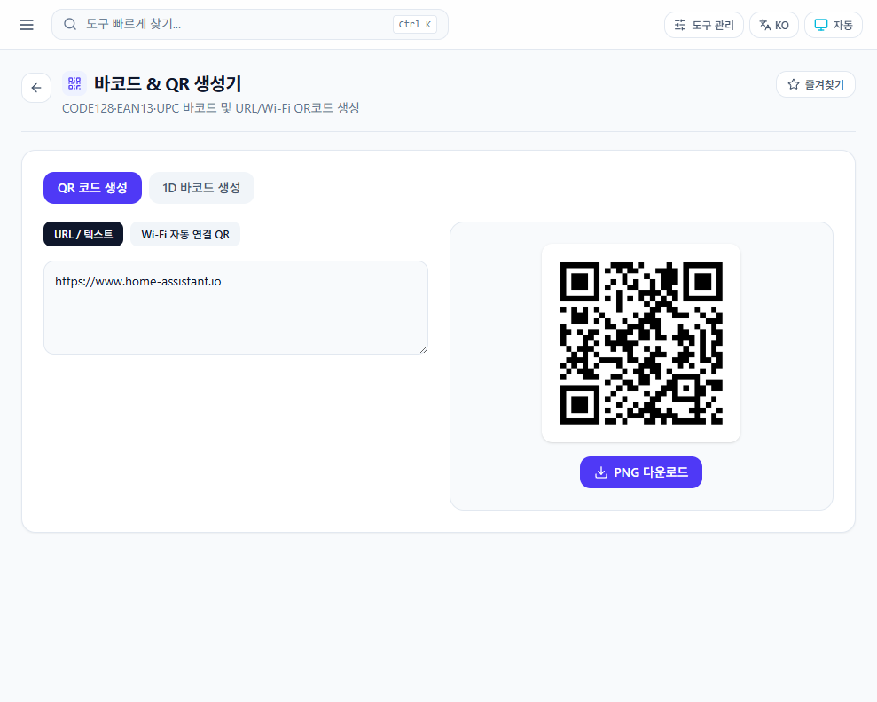

# Good Tools for Home Assistant

[](https://my.home-assistant.io/redirect/supervisor_add_addon_repository/?repository_url=https%3A%2F%2Fgithub.com%2Fredchupa%2Fha_good_tools)

일상에서 가끔 꼭 필요한 자잘한 도구들을 Home Assistant 안에 모아둔 앱입니다.

PDF 합치기나 사진 용량 줄이기, QR코드 만들기, 글자수 세기 같은 작업은 자주 쓰진 않는데 막상 필요할 때마다 검색해서 들어가면 광고가 가득하거나 회원가입을 요구하는 사이트가 많습니다. 개인 서류나 사진을 모르는 외부 사이트에 올리기도 찜찜하고요.

그래서 집에서 24시간 켜져 있는 Home Assistant 사이드바에 두고, 필요할 때마다 바로 열어 쓰려고 만들었습니다.

---

## 이런 상황에서 쓰면 편합니다

- **관공서나 회사에 낼 PDF 서류를 합치거나 나눠야 할 때**  
  여러 장의 PDF를 하나로 합치거나, 필요한 페이지만 골라낼 수 있습니다. 사진 여러 장을 PDF 한 파일로 묶는 것도 됩니다. 파일이 외부 서버로 올라가지 않고 내 브라우저 안에서 바로 처리됩니다.

- **블로그나 중고거래에 사진 올리기 전에 용량을 줄이고 싶을 때**  
  이미지 크기를 줄이고 파일 형식을 바꿀 수 있습니다. 변환 과정에서 사진에 들어있는 촬영 위치(GPS)나 카메라 정보도 같이 지워집니다.

- **PC에서 보던 링크나 메모를 휴대폰으로 넘기고 싶을 때**  
  `가족 공유 클립보드`에 붙여넣어 두면 휴대폰 Home Assistant 앱에서 바로 복사할 수 있습니다. 자주 쓰는 메모는 상단에 고정해 둘 수도 있습니다.

- **집에 손님이 왔을 때 와이파이 비밀번호 알려주기 번거로울 때**  
  `바코드 & QR 생성기`에서 Wi-Fi 이름과 비밀번호를 넣으면 카메라로 찍기만 해도 바로 연결되는 QR코드를 만들어 줍니다.

- **영타로 잘못 친 한글을 되돌리거나 글자수를 세야 할 때**  
  `dkssudgktpdy`처럼 영어로 잘못 친 문장을 다시 치지 않고 바로 한글로 바꿀 수 있고, 자소서나 문서 작성 시 공백 포함/제외 글자수와 바이트도 실시간으로 확인할 수 있습니다.

- **집 안 PC를 켜거나 기기 연결 상태를 확인하고 싶을 때**  
  같은 네트워크에 있는 PC에 Wake-on-LAN 신호를 보내 전원을 켜거나, 특정 포트가 열려 있는지 바로 확인할 수 있습니다.

- **그 외에 가끔 꼭 찾게 되는 것들**  
  아파트 평수 계산, D-Day·만 나이 계산, 도로명 우편번호 검색, 로또 번호 추첨, 자막 파일(SMI↔SRT) 변환, EML 이메일 파일 열기, GIF 만들기, 특수문자표, 단축 URL 원주소 확인, RSS 피드 모아보기 등 생활·업무·개발에 쓰이는 여러 도구가 함께 들어 있습니다.

---

## 설치 후 화면

메인 화면에서 원하는 도구를 검색(`Ctrl+K`)하거나 자주 쓰는 것만 즐겨찾기해 둘 수 있습니다. 안 쓰는 도구는 상단 `도구 관리`에서 숨겨두면 화면이 훨씬 깔끔해지고, 즐겨찾기나 숨김 설정은 PC와 휴대폰에 자동으로 같이 반영됩니다.

<p align="center">
  
</p>

<p align="center">
  
</p>

---

## 설치 방법

1. 위 **Add Repository** 버튼을 누르거나, Home Assistant의 **설정 → 앱(애드온) → 앱 스토어 → 우측 상단 메뉴(⋮) → 저장소**에 아래 주소를 추가합니다.
   ```text
   https://github.com/redchupa/ha_good_tools
   ```
2. 목록에서 **Good Tools**를 찾아 **설치** 후 **시작**합니다.
3. **사이드바에 표시**를 켜두면 왼쪽 메뉴에서 바로 열어 쓸 수 있습니다.

---

## ☕ 후원

이 앱이 도움이 되셨다면 따뜻한 커피 한 잔으로 응원해 주세요 🙏  
*(본 프로젝트의 모든 기능은 100% 무료로 제공되며, 후원은 순수 자발적 응원 목적입니다.)*

<table>
  <tr>
    <td align="center">
      <b>토스 (Toss)</b><br/>
      <br/>
      <code>1000-1261-7813</code> (우*만)
    </td>
    <td align="center">
      <b>PayPal</b><br/>
      
    </td>
  </tr>
</table>

<p align="center">
  <a href="https://github.com/sponsors/redchupa"></a>
  <a href="https://www.paypal.com/ncp/payment/HG9KNC262PLAC"></a>
</p>
