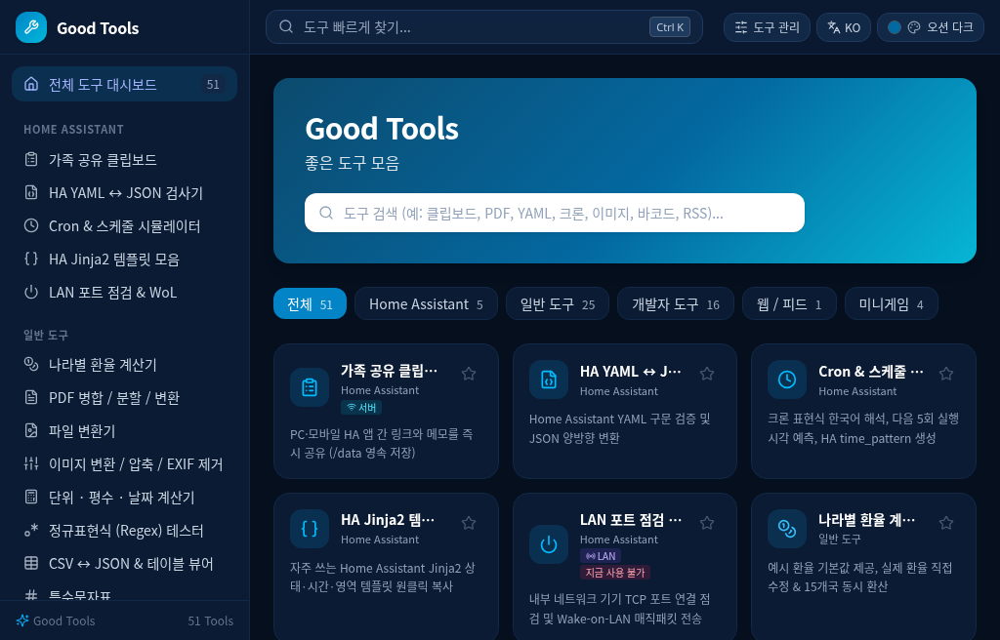
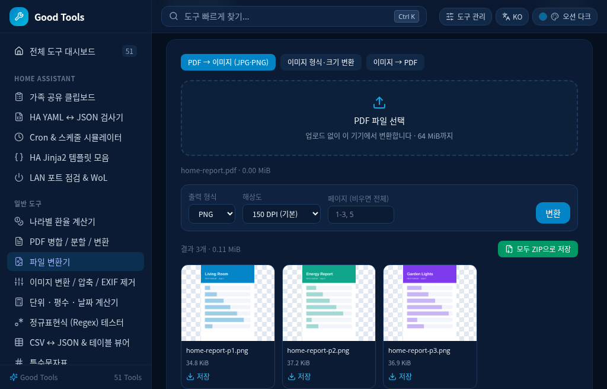
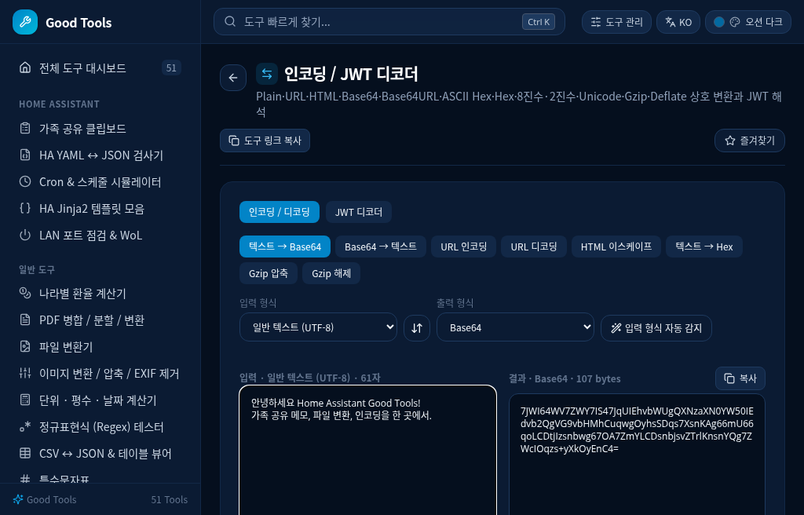
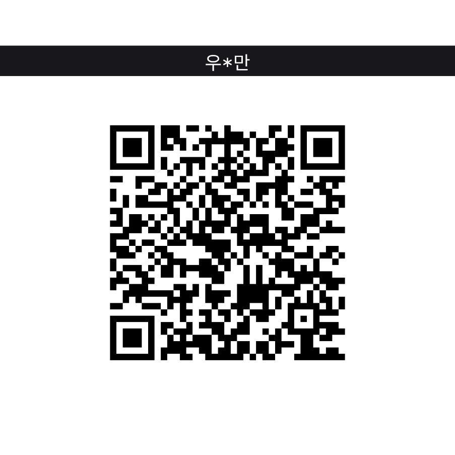

# Good Tools for Home Assistant

[](https://my.home-assistant.io/redirect/supervisor_add_addon_repository/?repository_url=https%3A%2F%2Fgithub.com%2Fredchupa%2Fha_good_tools)

일상에서 가끔 꼭 필요한 자잘한 도구들을 Home Assistant 안에 모아둔 앱입니다.

PDF 합치기나 사진 용량 줄이기, QR코드 만들기, 글자수 세기 같은 작업은 자주 쓰진 않는데 막상 필요할 때마다 검색해서 들어가면 광고가 가득하거나 회원가입을 요구하는 사이트가 많습니다. 개인 서류나 사진을 모르는 외부 사이트에 올리기도 찜찜하고요.

그래서 집에서 24시간 켜져 있는 Home Assistant 사이드바에 두고, 필요할 때마다 바로 열어 쓰려고 만들었습니다.

---

## 이런 상황에서 쓰면 편합니다

- **관공서나 회사에 낼 PDF 서류를 정리할 때**  
  PDF 여러 개를 하나로 합치거나 필요한 페이지만 뽑고, PDF를 JPG·PNG 사진으로 바꿀 수 있습니다. 파일은 외부로 올라가지 않고 내 기기 안에서 처리됩니다.

- **사진을 올리기 전에 용량을 줄이고 위치 정보를 지우고 싶을 때**  
  블로그나 중고거래에 올릴 사진의 크기와 형식을 바꾸면서 촬영 위치(GPS)와 카메라 정보도 함께 지웁니다.

- **PC에서 보던 링크나 메모를 휴대폰으로 넘길 때**  
  `가족 공유 클립보드`에 붙여넣으면 휴대폰 Home Assistant 앱에서 바로 복사할 수 있습니다. 자주 쓰는 메모는 위에 고정해 둘 수 있습니다.

- **손님에게 와이파이 비밀번호를 알려줄 때**  
  와이파이 이름과 비밀번호로 QR코드를 만들어 두면 카메라로 찍기만 해도 바로 연결됩니다.

- **영타로 잘못 친 한글을 고치거나 글자수를 셀 때**  
  `dkssudgktpdy`를 다시 칠 필요 없이 `안녕하세요`로 바꿔 주고, 공백 포함·제외 글자수를 바로 보여 줍니다.

- **Home Assistant 자동화를 만들 때**  
  YAML 문법 검사, 크론 표현식이 언제 실행되는지 미리보기, 자주 쓰는 Jinja 템플릿 모음을 한곳에서 쓸 수 있습니다.

이 밖에도 생활·개발에 쓰는 도구가 50개 이상 들어 있습니다.

---

## 설치 후 화면

도구를 검색하거나 즐겨찾기해 두면 PC와 휴대폰에서 똑같이 보입니다.

<p align="center">
  
</p>

<p align="center">
  
</p>

<p align="center">
  
</p>

---

## 설치 방법

1. 위 **Add Repository** 버튼을 누르거나, Home Assistant의 **설정 → 앱(애드온) → 앱 스토어 → 우측 상단 메뉴(⋮) → 저장소**에 아래 주소를 추가합니다.
   ```text
   https://github.com/redchupa/ha_good_tools
   ```
2. 목록에서 **Good Tools**를 찾아 **설치** 후 **시작**합니다.
3. **사이드바에 표시**를 켜두면 왼쪽 메뉴에서 바로 열어 쓸 수 있습니다.

---

## ☕ 후원

이 앱이 도움이 되셨다면 따뜻한 커피 한 잔으로 응원해 주세요 🙏

<table>
  <tr>
    <td align="center">
      <b>토스 (Toss)</b><br/>
      <br/>
      <code>1000-1261-7813</code> (우*만)
    </td>
    <td align="center">
      <b>PayPal</b><br/>
      
    </td>
  </tr>
</table>

<p align="center">
  <a href="https://github.com/sponsors/redchupa"></a>
  <a href="https://www.paypal.com/ncp/payment/HG9KNC262PLAC"></a>
</p>
